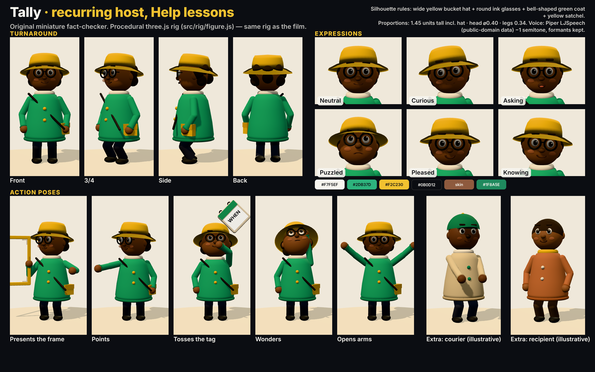

# Tally — recurring host for Help lessons



**Who:** an original miniature neighbourhood fact-checker who investigates how practical help really works. Curious, warm,
precise; never preachy. Pronouns: they/them. Not based on any existing character.

**Silhouette (never change):** wide yellow bucket hat (`#F2C230`, green band `#1F8A5E`) · round ink glasses · curly dark hair ·
bell-shaped green coat (`#2DB37D`) with two yellow buttons and cream collar · yellow satchel on the right hip with ink strap ·
dark trousers, ink shoes. Skin `#8E5A3E`.

**Proportions (rig units):** legs 0.34 · torso/coat 0.57 · head ⌀ 0.40 · ≈1.45 tall incl. hat. Same scale as extras so
nobody is visually "smaller" (dignity rule).

**Rig:** `src/rig/figure.js` → `createFigure(opts)`; one builder for Tally and extras. Controls: root x/z/yaw, lean, twist,
squash, bob, head yaw/pitch/roll, brows (raise + tilt), blink, pupils (look x/y), mouth open (lip-sync curve), smile/frown,
two-bone IK arms (torso-local or world targets, e.g. prop grips), IK legs with foot lift. Tally options:
```js
{ skin:'#8E5A3E', hair:'#22160F', coat:'#2DB37D', coatDark:'#1F8A5E', trousers:'#2B3140', shoe:'#14171D', accent:'#F2C230',
  hat:'bucket', hatColor:'#F2C230', hatBand:'#1F8A5E', glasses:true, satchel:true, hairStyle:'curls' }
```

**Expressions (sheet):** neutral, curious, asking, puzzled, pleased, knowing. **Action vocabulary:** presents a prop,
points, tosses, wonders/scratches head, opens arms, knowing nod. Tally *does* the mechanism; never just stands beside text.

**Voice:** Piper `en_US-ljspeech-medium` (public-domain LJ Speech data), FFmpeg `rubberband=pitch=0.9439:formant=preserved`
(−1 semitone), +2 dB @220 Hz, +1.5 dB @3.2 kHz, 2.5:1 compression. Comfortable pace (~3 words/s max), no speed-up.

**Known nit for episode 02:** the satchel strap reads as a thin diagonal line; consider a wider, flatter strap mesh
(change the rig *and* re-render the sheet together so they stay in sync).
