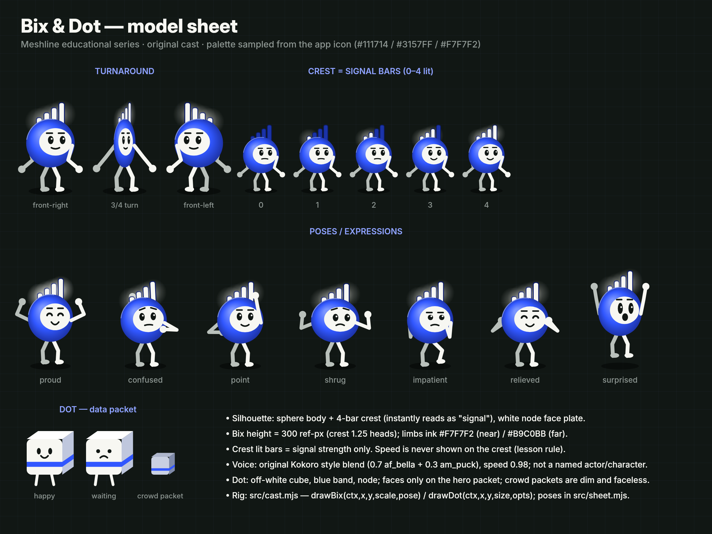

# Recurring cast: Bix & Dot (Meshline lessons)



The model sheet is regenerated from code: `node src/sheet.mjs character/model-sheet.png`.

## Bix, the signal sprite (performer and narrator)
- **Silhouette:** an electric-blue sphere body (`#3157FF`, shaded from `#7B96FF` to `#1A2E9C`) with a **four-bar crest** that reads as "signal" at any size. The crest lights 0–4 bars and only ever means signal strength, never speed.
- **Face:** a white node plate (`#F7F7F2`, the icon's node), charcoal eyes with highlights, brows and a mouth. Expressions: neutral, proud (^ ^ eyes), confused, pointing, shrug, impatient, relieved, surprised.
- **Limbs:** ink lines with round hands and feet, driven by two-bone IK. Near limbs are `#F7F7F2` and far limbs `#B9C0BB`. Bix always casts a contact shadow.
- **Acting principles** (from the `animation-direction` skill): anticipation → action → impact → recovery (wind-up/throw, tap/jolt, catch). Props explain cause and effect (Dot, phone, meter, queue).
- **Voice:** an original synthetic voice, a linear blend of two Apache-2.0 Kokoro-82M style vectors (0.7 `af_bella` + 0.3 `am_puck`) at speed 0.98, generated locally by `audio/voice.py`. It is not modelled on any real person, actor or existing character.

## Dot, the data packet (companion)
- An off-white rounded cube with a blue band and node, a tiny face and stick legs. The hero Dot has a face; crowd packets are dim and faceless.
- Dot is the thing that has to get through. It is thrown, it waits in queues, it returns with the page, and it sits on props.

## Rig API (`src/cast.mjs`, reusable across lessons)
```js
drawBix(ctx, x, y, scale, pose)   // pose keys: face, lean, squash, lift, bars, barGlow, look, eye, happyEyes,
                                  // brow, browTilt, mouth, mouthO, handN, handF, footN, footF
                                  // returns {handN, handF, head, scale} in screen space for attaching props
drawDot(ctx, x, y, size, { mood, eye, legs, tap, t, face, dim, alpha, rot })
```
Named poses are in `src/sheet.mjs` (`POSES`) and `src/pilot.mjs` (`POSE`). Characters are billboards placed via `project()` from `src/core.mjs`, so they live inside the 3D glass city.

## Consistency rules for future episodes
- Keep fixed: proportions (body radius 78, crest bars 26/42/58/74 ref-px), colours, face layout, crest meaning, voice blend and speed.
- Vary per lesson: setting, camera, props and choreography. Never repeat the same blocking twice in a row.
