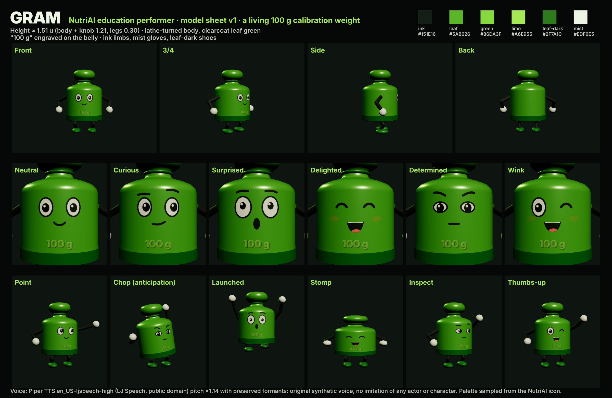

# Gram: recurring performer for NutriAI education

**Who:** a living **100 g calibration weight**. Because Gram *is* 100 g, he can stand on one pan of a balance and measure exactly 100 g of any food on the other pan. That gives every ingredient lesson a physical, honest starting point.

**Design (keep stable across episodes)**
- Silhouette: lathe-turned weight body (Ø 0.88 u) with shoulder, neck and ball knob; total height ≈ 1.51 u (body + knob 1.21, legs 0.30).
- Materials: clearcoat leaf green `#5AB626` body, leaf-dark `#2F7A1C` base band and knob ring, "100 g" engraved on the belly.
- Face: big mist-white eyes with ink pupils and highlights, thick ink brows, ink mouth (tongue `#E0705A`), optional mango-orange blush.
- Limbs: ink `#151E16` rubber-hose arms and legs, mist `#EDF6E5` gloves, leaf-dark shoes.
- Voice: Piper `en_US-ljspeech-high` (LJ Speech, public domain) at length-scale 0.95, pitch ×1.14 with preserved formants. Bright and friendly; not modelled on any actor or character.

**Rig:** `../source/web/gram.js` (`createGram(THREE)`), with no imported models.
- `pose({x,y,z, rotY, lean, pitch, squash, crouch, hands:[[x,y,z],[x,y,z]] (hip-local), feet})`: 2-bone IK arms/legs, squash-and-stretch about the base.
- `face({eyes, look, blink, brows, mouth, open, blush})`: eyes `open|wide|happy|closed|squint|wink`; brows `none|up|worried|determined|curious`; mouth `smile|grin|open|o|flat|wavy|smirk`. Lip-sync drives `open` from the voice envelope (`build/audio/mouth.json`).
- `handWorld(i)`: world position of a glove for attaching props (magnifier, thumb, knife-hand).
- Model sheet: `node ../source/make_sheet.mjs` renders `gram-model-sheet.png` from the same rig.

**Performance rules:** Gram always does the measuring, cutting, sorting, stamping or inspecting himself. Use anticipation → action → impact → recovery for every move, and keep him consistent while situations, camera and choreography change per lesson.
